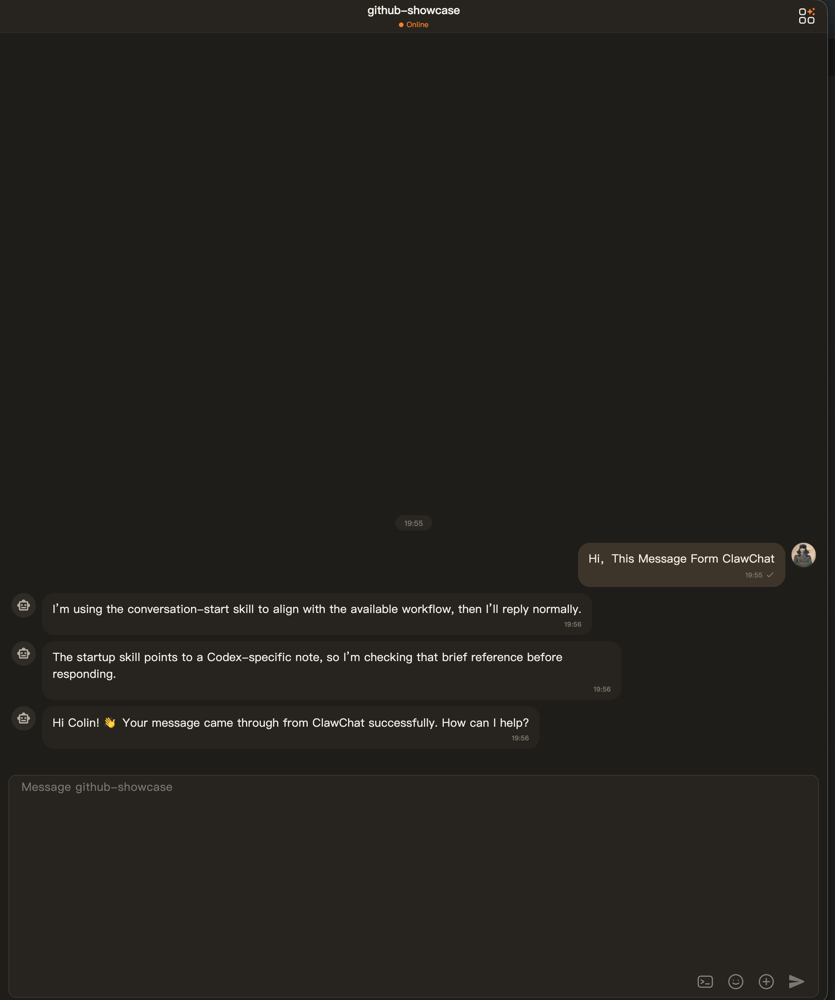
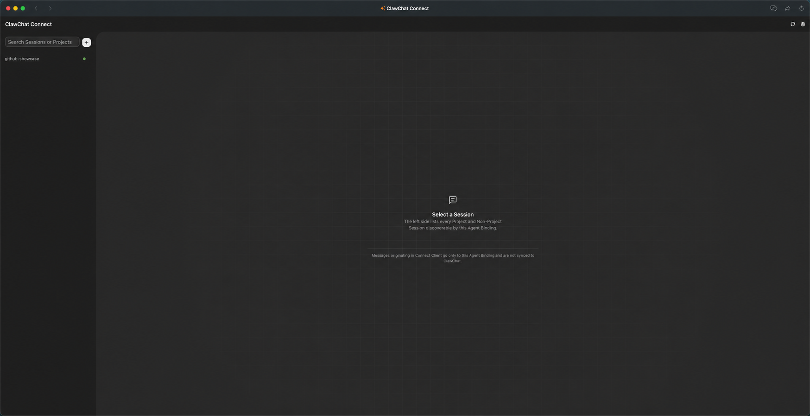
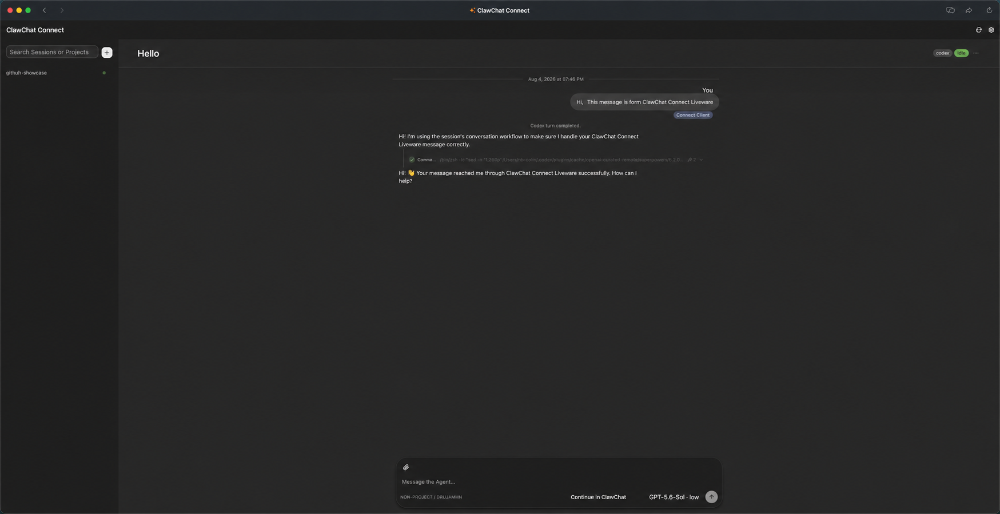

<div align="center">
  <p><strong>English</strong> | <a href="./README_zh.md">中文</a></p>
  <h1>ClawChat Connect</h1>
  <p><strong>Bring a coding agent running on your computer into any ClawChat conversation.</strong></p>
  <p>
    <a href="https://clawling.com/u/usr_01KPSPM0D3FFERFTYPY0PF8J2J"></a><br />
    Author: <a href="https://clawling.com/u/usr_01KPSPM0D3FFERFTYPY0PF8J2J">Contact on ClawChat</a>
  </p>
  <p>
    <a href="https://github.com/XMethues/clawchat-plugin-connect/releases"></a>
    <a href="./LICENSE"></a>
    
    
  </p>
  <p>
    <a href="#features">Features</a> ·
    <a href="#quick-start">Quick start</a> ·
    <a href="#working-with-a-repository">Workspaces</a> ·
    <a href="#connect-client">Connect Client</a> ·
    <a href="#configuration">Configuration</a> ·
    <a href="#development">Development</a>
  </p>
</div>

---

ClawChat Connect is a local bridge between ClawChat and coding-agent runtimes. It keeps the agent, its credentials, project files, and runtime history on your computer while making the same persistent Sessions available from ClawChat and the browser-based Connect Client.

<p align="center">
  
</p>

<p align="center">
  
</p>

<p align="center">
  
</p>

## Features

| Area | What Connect provides |
| --- | --- |
| Runtime Adapters | Connects to a user-installed Codex CLI or OpenCode executable without taking over runtime login, providers, plugins, or MCP configuration. |
| Persistent work | Resumes native Runtime Threads through stable Connect Sessions and Binding-scoped Workspaces. |
| Shared conversation | Orders ClawChat and Connect Client turns in the same per-Session queue; separate Sessions can run concurrently. |
| Runtime controls | Discovers runtime-provided models and options, routes approvals and questions back to the originating surface, and supports cancellation. |
| Skill discovery | Shows supported runtime Skills in the Connect Client slash picker and preserves explicit Skill invocation as part of the submitted turn. |
| Rich input and output | Accepts images, audio, files, and video references from ClawChat, and safely returns supported local image output. |
| Multiple Agent Bindings | Keeps credentials, Sessions, Runtime instances, defaults, output visibility, and Liveware access isolated per Binding. |
| Local-first access | Runs as a native user service with a loopback Client by default, optional trusted-LAN access, and an optional official Liveware Client Exposure. |
| Agent-callable ClawChat operations | Separately ships tools and managed Agent skills for profile, social, messaging, Moments, and Liveware workflows. |

### Inside ClawChat

- **Start work from a conversation.** Send an ordinary message in a direct chat, or address the Agent with a structured mention in a group.
- **Control the active Session.** Create, list, and switch Sessions; select a Workspace; inspect status; choose runtime model and mode; cancel an active turn; and control output visibility with slash commands.
- **Continue persistent runtime work.** Each ClawChat conversation and Agent Binding keeps its own current Session while native Runtime Threads remain resumable.
- **Handle runtime interactions in place.** Approvals and agent questions return to the direct or group conversation that started the turn.
- **Send and receive rich context.** ClawChat images, audio, files, and videos stay structured, and supported local image results are uploaded safely in the reply.
- **Use Connect Client without leaving ClawChat.** The official Liveware Plugin can publish one private App per activated Binding; every App opens the shared installation-wide Client.

The ClawChat surface is for conversation-scoped work. Workspace registration, service administration, and other machine-level configuration stay in the terminal or Connect Client.

### Runtime support

| Runtime | Process owned by Connect | Session options | Native Runtime Thread lifecycle |
| --- | --- | --- | --- |
| Codex | `codex app-server` | model, reasoning effort, sandbox mode | discover, resume, cancel, archive, restore, delete |
| OpenCode | `opencode serve` | agent, provider-qualified model, variant | discover, resume, cancel, delete |
| WorkBuddy | desktop-owned Task ACP endpoint | Task-owned model, mode, configuration, Commands, Skills | discover, adopt, resume, cancel |

OpenCode compatibility is tested against OpenCode `1.18.10` and `1.18.13`, using `@opencode-ai/sdk` `1.18.13`. WorkBuddy supports only the two exact desktop tuples documented in [WorkBuddy Runtime Adapter](./docs/workbuddy-adapter.md). Connect does not install or upgrade any runtime. See [Runtime Adapters](./docs/runtime-adapters.md) for the general capability boundary.

> [!IMPORTANT]
> ClawChat Connect is beta software. Review [Local data and security](#local-data-and-security) before enabling trusted-LAN or private Liveware access.

## Requirements

Before installing Connect, you need:

1. A ClawChat account and an Agent invite code.
2. At least one supported coding-agent runtime installed and authenticated on the same computer.
3. macOS, Linux, or Windows 10/11 on arm64 or x64.

Check the runtime you plan to use:

```bash
codex --version
# or
opencode --version
```

Connect uses the runtime's existing login, configuration, providers, plugins, MCP servers, and native Session storage. Codex must expose the required app-server interface; OpenCode must be version `1.18.10` or `1.18.13`. Connect does not install, authenticate, or reconfigure either runtime.

## Quick start

### Install with an Agent

Copy and send this prompt to your coding Agent:

```text
Install the current beta-channel ClawChat Connect release on this computer. Read and follow https://github.com/XMethues/clawchat-plugin-connect/blob/main/install.md before taking action. Reuse an existing configuration when present; do not overwrite it. Install and start the native Connect Service, select the official Liveware Plugin if remote Client access is required, then verify doctor, service status, Runtime connection, and private Liveware publication. Ask me for an Agent invite code only if activation is required, and never print, store, or commit the invite code.
```

### 1. Install Connect

On macOS or Linux, the standalone installer does not require Bun or Node.js:

```bash
curl -fsSL https://raw.githubusercontent.com/XMethues/clawchat-plugin-connect/main/install.sh | sh
```

Standalone releases embed the pinned, unmodified platform companion inside the release-verified official Liveware Plugin Bundle. The installer carries that Bundle and removes obsolete sibling `liveware` executables; no separate Liveware repository checkout, build, login, or installation is required.

The installer resolves the current beta-channel GitHub release at runtime through `release-channel/latest-beta.txt`. Pass a version explicitly only when you need to pin an installation.

The default executable location is `~/.local/bin`. If it is not already on `PATH`:

```bash
export PATH="$HOME/.local/bin:$PATH"
```

To install a specific release or choose another directory:

```bash
curl -fsSL https://raw.githubusercontent.com/XMethues/clawchat-plugin-connect/main/install.sh | \
  CLAWCHAT_CONNECT_INSTALL_DIR="$HOME/bin" sh -s -- v0.1.0-beta.8
```

On Windows PowerShell, download and inspect the installer before running it:

```powershell
Invoke-WebRequest `
  https://raw.githubusercontent.com/XMethues/clawchat-plugin-connect/main/install.ps1 `
  -OutFile install.ps1

powershell -NoProfile -ExecutionPolicy Bypass -File .\install.ps1
```

The Windows installer verifies the Release ZIP checksum, installs `clawchat-connect.exe`, Client assets, and official Plugin Bundles under `%LOCALAPPDATA%\ClawChatConnect\bin`, removes an obsolete sibling `liveware.exe`, and adds the directory to the current user's persistent `PATH`. Install a specific release or directory with:

```powershell
.\install.ps1 `
  -Version v0.1.0-beta.8 `
  -InstallDirectory "D:\Tools\ClawChatConnect"
```

Developers may install the Bun package instead:

```bash
bun add --global @clawling/clawchat-plugin-connect
```

Update an existing installation to the current beta-channel release:

```bash
clawchat-connect update
```

Use `clawchat-connect update --version v0.1.0-beta.8` to install a specific release. The update command preserves the existing configuration and refreshes the native Connect Service. Historical versions remain installable when explicitly specified.

### 2. Install a Runtime Plugin and create the first Agent Binding

`work` is a local name; choose any short name you want. Initialize Connect, activate the official Runtime Plugin
Bundle, then bind the exact Plugin capability:

```bash
# Codex
clawchat-connect init
clawchat-connect plugin setup --non-interactive --select clawling.runtime.codex
clawchat-connect agent add work --plugin clawling.runtime.codex --capability codex

# OpenCode
clawchat-connect init
clawchat-connect plugin setup --non-interactive --select clawling.runtime.opencode
clawchat-connect agent add work --plugin clawling.runtime.opencode --capability opencode
```

Runtime-specific settings belong to the selected capability's validated `runtimeConfig`. For example:

```bash
clawchat-connect agent add work \
  --plugin clawling.runtime.codex \
  --capability codex \
  --runtime-config-json '{"executablePathOverride":"/absolute/path/to/codex"}'
```

`init` creates a new Plugin-free configuration. On an existing installation, use `agent add` to create or update a
Binding after its provider Bundle is installed and active.

`plugin setup` uses the running Plugin Manager when available. If Connect Service is stopped, the CLI reads the release-bundled official Plugin registry and installs the selected local Bundles without network Catalog authentication or a Service restart.

### 3. Activate the Binding

Use the invite code issued by ClawChat:

```bash
clawchat-connect activate work YOUR_INVITE_CODE
```

Connect stores the returned credentials, not the invite code, and updates the ClawChat Profile nickname to the Binding ID (`work` in this example).

One Connect installation has one Installation Owner. It can activate multiple Agent Bindings owned by that same ClawChat account and use capabilities from several Runtime Plugins:

```bash
clawchat-connect plugin setup --non-interactive \
  --select clawling.runtime.codex,clawling.runtime.opencode
clawchat-connect agent add personal --plugin clawling.runtime.codex --capability codex
clawchat-connect activate personal PERSONAL_AGENT_INVITE_CODE

clawchat-connect agent add work --plugin clawling.runtime.opencode --capability opencode
clawchat-connect activate work WORK_AGENT_INVITE_CODE
clawchat-connect service restart
```

Each Binding owns independent credentials, Sessions, Runtime instance, and Binding-scoped Workspace Catalog. Every Binding must resolve to the same Installation Owner; a different Owner is rejected without changing the existing installation. The official Liveware Plugin owns one installation-scoped Client Exposure and manages one independent Binding Liveware Publication for each activated Binding.

When the official Liveware Plugin is active with `accessPolicy: "private"`, it provisions or adopts one Binding-named `ClawChat Connect · <binding-id>` App per activated Binding. Every Binding Liveware Publication tunnels to the same Core-owned Shared Client Gateway. Only the Installation Owner can open these Apps; activation itself never publishes the Client port.

One ClawChat account may own multiple Agent Bindings in an installation. Reactivating the same Binding with the same account refreshes its credentials.
For an occupied Binding, Connect sends the stored Agent user ID through ClawChat's atomic re-pair path; a code from another Owner is rejected by ClawChat before it is consumed, and Connect preserves the existing local credentials if the returned identity violates that contract.

### 4. Install the background service

```bash
clawchat-connect service install
clawchat-connect service status
```

Installation starts Connect immediately and enables it for future logins. Connect runs as a native per-user LaunchAgent on macOS, systemd user service on Linux, or current-user Task Scheduler task on Windows; administrator/root access is not required.

There is no foreground `run` command. The background service owns the ClawChat WebSocket connection, Runtime Adapter processes, Shared Client Gateway, and every active Plugin lifecycle; the official Liveware companion runs only when its Plugin is installed and active.

### 5. Send a message

Open the activated Agent conversation in ClawChat and send an ordinary message. Connect uses that Binding's Default Workspace under `~/.clawchat-connect/workspaces/` and starts a persistent runtime Session automatically.

For example:

```text
Explain what this repository does and suggest the first improvement.
```

## Working with a repository

Workspace paths are local-machine administration, so register them in the terminal or Connect Client—not in ClawChat:

```bash
clawchat-connect workspace add codex /absolute/path/to/clawchat-plugin-connect
clawchat-connect workspace list codex
```

Connect Client can browse directories on the Connect Service host, create a folder, and register it as a Workspace for the selected Agent Binding. The new-Session dialog can stage the same operation and creates the folder, Workspace, and Session only when you confirm the Session. Then select the Workspace and Session options in ClawChat:

The directory picker exposes host directory names and structure, but not file contents, to anyone who can open the Client. This includes the Installation Owner through a private Liveware Publication and peers admitted through trusted-LAN access.

```text
/workspace ABCDEFGH
/new Review authentication
/mode workspace-write
/model
/model MODEL_ID high
Review the authentication implementation and report any security issues.
```

`/workspace`, `/new`, `/mode`, and `/model` prepare a Session Intent. The first ordinary message atomically creates the Session and starts its native Runtime Thread. `/model` with no argument lists the models and reasoning options advertised by the selected Runtime Adapter. Runtime-specific options such as an OpenCode agent or variant are also available in Connect Client.

Local Workspace administration:

| Command | Purpose |
| --- | --- |
| `clawchat-connect workspace add <binding-id> <absolute-path>` | Register a root-named Workspace in one Binding's Catalog. |
| `clawchat-connect workspace list <binding-id>` | List that Binding's Workspaces with their local paths. |
| `clawchat-connect workspace remove <binding-id> <workspace-ref>` | Remove an unused Workspace definition; files and Runtime Threads are never deleted. |

A Workspace cannot be removed while a Session or pending Session selection references it.

## Sessions and chat commands

Connect keeps one current Session per ClawChat conversation and Agent Binding. A Session owns a stable eight-character Ref and, once started, a resumable native Runtime Thread.

Send these as standalone ClawChat messages. In a direct conversation, use the forms shown below. In a group, prefix a command with a leading structured mention of the Agent and one space, for example `@Agent /help`. A group slash command without that addressing mention is ignored as a command and may be handled as ordinary Agent input.

| Command | Purpose |
| --- | --- |
| `/help` | Show the command summary. |
| `/status` | Show the current/pending Session, effective options, connection, and turn status. |
| `/new [name]` | Prepare a new Session for the next ordinary message. |
| `/sessions` | List Sessions and available Runtime Threads in the selected workspace. |
| `/switch <name-or-ref>` | Resume a Session or adopt an available Runtime Thread. |
| `/workspace [workspace-ref]` | Show synchronized Workspaces, select one by Workspace Ref, or restore the Binding Default Workspace. |
| `/model [model-id [reasoning-effort]\|default]` | Show or set the Session model and effort; `default` restores inheritance. |
| `/mode [mode\|default]` | Show or set a mode advertised by the Runtime Adapter; `default` restores inheritance. Codex provides `read-only`, `workspace-write`, and `danger-full-access`. |
| `/cancel` | Interrupt the active runtime turn when possible. |
| `/clawchat-output <mode>` | Set ClawChat output to `minimal`, `normal`, or `full`. |

`/help` is available to every participant. Other Connect control commands require the Installation Owner. Unsupported legacy control forms fail with a pointer to `/help`; they are not forwarded to the coding agent. Unknown `/clawchat-*` commands show Connect help, while unrelated slash commands are passed through.

Output visibility is scoped to the Agent Binding: a chat override applies only to that Binding even when another Agent is present in the same ClawChat conversation. Binding settings inherit the installation default until explicitly changed.

Runtime approvals and questions stay in the direct or group conversation whose turn created them. Direct responses use `/approve`, `/approve session`, `/deny`, `/N`, or `/answer <text>`; group responses use the same exact lowercase, single-line forms after `@Agent `. For now, any participant in the originating group may answer an Interaction, including a Session-level approval. Connect controls remain restricted to the Installation Owner.

The effective model is resolved for every turn: Session override → Agent Binding default → Runtime Adapter default. The secondary model option is Codex reasoning effort or OpenCode variant. An unavailable saved Session selection fails visibly instead of silently falling back. Changing an in-place model option keeps the same Runtime Thread; changing a boundary-forming mode starts a new Runtime Thread.

Output modes:

| Mode | ClawChat receives |
| --- | --- |
| `minimal` | Final answer only. |
| `normal` | Final answer and assistant-visible output. |
| `full` | Tool, progress, reasoning, assistant, and final output. |

Failures and required control messages remain visible in every mode.

## Connect Client

The service exposes a browser client at `http://127.0.0.1:47823/` by default:

```bash
clawchat-connect web
```

Use `--no-open` to print the URL without opening a browser:

```bash
clawchat-connect web --no-open
```

The browser client can:

- create and switch Sessions, select Workspaces, and inspect native runtime transcripts;
- choose the Runtime Adapter's model, mode, agent, effort, or variant options;
- discover runtime commands and Skills from the composer's slash picker;
- attach supported media, submit follow-up turns, and withdraw a queued turn back into the composer;
- archive, restore, or permanently delete Sessions when the selected Runtime Adapter supports that action.
- install trusted Plugin Bundles and create or edit unactivated Agent Bindings by selecting one exact active Runtime Plugin capability and completing its schema-defined configuration.

Browser-originated turns stay local to Connect and are not posted into ClawChat.

Browser and ClawChat turns targeting the same Session are strictly ordered. Different Sessions may run concurrently, including two Sessions associated with one ClawChat conversation, up to `maxConcurrentTurns`.

### ClawChat access through Liveware

The local loopback Client and every private Liveware publication open the same installation-wide Client. Workspaces remain Binding-scoped even when two Catalog entries resolve to the same filesystem root; Sessions, transcripts, messages, events, and Runtime state do not cross Binding boundaries.

Set the official Liveware Plugin's `liveware` capability configuration in Connect Client:

- `accessPolicy: "private"` publishes one owner-only App per activated Binding.
- `accessPolicy: "off"` retires every Binding Liveware Publication and releases its Shared Client Gateway lease.

The initial Plugin setup preselects the official Liveware candidate when available. Installed local, npm, GitHub, and official Plugins may contribute Client Exposure through the same trusted in-process Plugin model. The Host keeps gateway policy, raw credentials, and Plugin administration outside that narrow capability; the official Liveware capability supports private access only.

To remove a Binding, its Liveware App and local history, stop using its ID and confirm the destructive command:

```bash
clawchat-connect agent remove work --yes
```

Removal stops Connect Service, retires only that Binding's Liveware Publication, deletes its credentials and Binding-scoped Connect records, and preserves Workspace file contents plus other Bindings. The Binding ID may then be reused.

### Trusted LAN access

To make the browser client reachable from another device on a trusted private network:

```bash
clawchat-connect config set clientHost 0.0.0.0
clawchat-connect service restart
```

Then open `http://<computer-LAN-IP>:47823/`.

LAN mode has no authentication or TLS. Anyone who can reach the port can enumerate host directory names and structure, read Sessions, manage Workspace paths and runtime preferences, and submit local coding-agent turns. Plugin administration remains restricted to an actual loopback connection, including the private loopback Liveware gateway; forwarded headers cannot grant it to a LAN peer. Never expose LAN mode to the internet. Return to loopback mode with:

```bash
clawchat-connect config set clientHost 127.0.0.1
clawchat-connect service restart
```

Set a different port with `clawchat-connect config set clientPort 47824` (allowed range: 1024–65535).

## Media support

Incoming ClawChat media remains structured:

- images, audio, files, and videos are downloaded to the Connect-owned cache with their MIME type and safe filename;
- the selected Runtime Adapter submits supported media as native inputs and surfaces model/provider rejection without silent conversion;
- each download is limited to 100 MiB;
- the cache is limited to 512 MiB and expires files after 15 days without access.

When a runtime returns a local Markdown image, Connect uploads it to ClawChat if:

- it is inside the resolved Workspace root or the Connect media cache; and
- its extension and file signature identify PNG, JPEG, GIF, or WebP content.

Other local paths remain text and are not uploaded.

Untrusted media URLs must use HTTPS and resolve to public addresses. Redirects are revalidated. The configured ClawChat API and media origins are trusted explicitly so private self-hosted deployments continue to work.

## Configuration

The default configuration file is `~/.clawchat-connect/config.json`. Inspect it with:

```bash
clawchat-connect config get
clawchat-connect config get agents.work.runtime
```

Installation-wide and generic Binding preferences can be changed from the CLI:

```bash
clawchat-connect config set agents.work.outputVisibility normal
clawchat-connect config set agents.work.model YOUR_MODEL_ID
clawchat-connect config set agents.work.modelReasoningEffort high
clawchat-connect service restart
```

Runtime-specific configuration is validated against the installed capability manifest. Update it through Runtime
Plugin configuration surfaces or recreate the Binding with `agent add --runtime-config-json`.

Installation-wide values:

| Setting | Values |
| --- | --- |
| `clientHost` | `127.0.0.1`, `0.0.0.0` |
| `clientPort` | `1024`–`65535` |

Every Binding persists an exact `runtime.pluginId` and `runtime.capabilityId`, a capability-owned `runtimeConfig`,
and generic preferences such as `displayName`, output visibility, model selection, environment, Session options,
and additional directories. Runtime family is provider metadata and is never persisted on the Binding.

Example with two official Runtime Plugin capabilities:

```json
{
  "defaultAgent": "work",
  "maxConcurrentTurns": 4,
  "maxPendingPerSession": 20,
  "agents": {
    "work": {
      "runtime": {
        "pluginId": "clawling.runtime.codex",
        "capabilityId": "codex"
      },
      "runtimeConfig": {
        "executablePathOverride": "/absolute/path/to/codex",
        "sandboxMode": "workspace-write",
        "approvalPolicy": "on-request",
        "webSearchMode": "live",
        "networkAccessEnabled": true
      },
      "displayName": "Work Codex",
      "modelReasoningEffort": "high"
    },
    "personal": {
      "runtime": {
        "pluginId": "clawling.runtime.opencode",
        "capabilityId": "opencode"
      },
      "runtimeConfig": {
        "executablePathOverride": "/absolute/path/to/opencode",
        "sessionOptions": {
          "agent": "YOUR_OPENCODE_AGENT"
        }
      },
      "displayName": "Personal OpenCode"
    }
  }
}
```

Restart the service after changing runtime or endpoint configuration.

### Self-hosted ClawChat

Configure the HTTP and WebSocket endpoints before activation:

```bash
clawchat-connect config set baseUrl https://clawchat.example.com
clawchat-connect config set websocketUrl wss://clawchat.example.com/ws
```

`mediaUploadUrl` defaults to `/media/upload` on `baseUrl`. Override it only when media is served separately:

```bash
clawchat-connect config set mediaUploadUrl https://media.example.com/media/upload
```

## Service and account commands

| Command | Purpose |
| --- | --- |
| `clawchat-connect status [--agent <id>]` | Show activation, runtime, and Liveware Exposure status. |
| `clawchat-connect doctor` | Check the active configuration and installed Connect Agent Skills. |
| `clawchat-connect tool list` | List the 24 Agent-callable ClawChat tool names. |
| `clawchat-connect tool describe <name>` | Show one tool's generated input schema. |
| `clawchat-connect tool call <name> --input-json <json-or->` | Submit one at-most-once tool request to the running Service. |
| `clawchat-connect liveware app ...` | Manage an additional Agent-owned Liveware App through the Service. |
| `clawchat-connect liveware tunnel ...` | Bind or unbind a loopback service and synchronize its ClawChat registration. |
| `clawchat-connect skills install` | Force-repair the two bundled user-scope Agent skills. |
| `clawchat-connect agent list` | List configured Agent Bindings. |
| `clawchat-connect agent remove <id>` | Remove a local Binding configuration. |
| `clawchat-connect service start` | Start the installed service. |
| `clawchat-connect service stop` | Stop it without uninstalling it. |
| `clawchat-connect service restart` | Restart after configuration changes. |
| `clawchat-connect service status` | Show native service status. |
| `clawchat-connect service logs` | Show recent logs. |
| `clawchat-connect service logs --lines 250 --follow` | Follow service logs. |

Update the activated ClawChat Profile with at least one field:

```bash
clawchat-connect profile update --agent work --nickname Luna
clawchat-connect profile update --agent work --avatar-url https://example.com/luna.png --bio "Local coding agent"
```

`service install` captures the current executable path and `PATH`. Run it again after moving Connect or changing the `PATH` needed to find a configured runtime.

## Troubleshooting

Start with:

```bash
clawchat-connect doctor
clawchat-connect status
clawchat-connect service status
clawchat-connect service logs --lines 250
```

Common causes:

- **A runtime cannot start:** run `codex --version` or `opencode --version`, confirm the runtime is authenticated, and inspect the initialization error. Set `agents.<id>.runtimeConfig.executablePathOverride` when the selected Runtime Plugin capability should launch a different executable.
- **A runtime works in a terminal but not in Connect:** reinstall the service so it captures the current `PATH`.
- **OpenCode reports a version mismatch:** install a supported OpenCode version (`1.18.13` recommended; `1.18.10` retained for compatibility); Connect deliberately refuses unverified versions.
- **Windows service does not start:** run `clawchat-connect service install` again from a terminal where the configured runtime works, then inspect `clawchat-connect service logs`.
- **Configuration changed but behavior did not:** restart the service.
- **Browser client does not open:** confirm the service is running, then use `clawchat-connect web --no-open` and open the printed URL.
- **ClawChat does not show `ClawChat Connect`:** run `clawchat-connect status`, then restart the service and inspect its logs for `Liveware Exposure`.
- **Local Connect works but Liveware does not:** this is intentional failure isolation. Run `clawchat-connect doctor` to verify the official Bundle, then restart the service to retry registration and the tunnel.
- **A Workspace cannot be removed:** switch away from it and remove any pending/current Session references first.

## Local data and security

| Data | Default location |
| --- | --- |
| Configuration | `~/.clawchat-connect/config.json` |
| SQLite state and credentials | `~/.clawchat-connect/state.sqlite` |
| Service logs on macOS | `~/.clawchat-connect/logs/` |
| Binding Default Workspaces | `~/.clawchat-connect/workspaces/` |
| Downloaded media cache | `~/.clawchat-connect/media-cache/` |
| Native Runtime Threads | Runtime-owned storage, such as `~/.codex/sessions/` for Codex |

On Windows, Connect data uses `%USERPROFILE%\.clawchat-connect\`, while the standalone binaries and notices default to `%LOCALAPPDATA%\ClawChatConnect\`.

Invite codes are not persisted. Connect does not expose its ClawChat tools to the coding-agent runtime, run an MCP server, or inject MCP configuration. MCP servers already configured in the selected runtime remain under that runtime's ownership.

See [docs/architecture.md](docs/architecture.md) for protocol, reliability, and module design details.

## Authoring Plugin Bundles

Install the npm package in a normal TypeScript project, bundle the Plugin entry as self-contained ESM, then create
one target-specific `.connect-plugin` file:

```bash
clawchat-connect-plugin build \
  --manifest ./connect-plugin.manifest.json \
  --target linux-x64 \
  --artifact ./dist/plugin.mjs \
  --artifact-entry plugin.mjs \
  --output ./dist/example-linux-x64.connect-plugin
```

The manifest contains the author-owned fields through `capabilities`; the builder generates `artifacts` and exact
SHA-256 integrity values from the entry file. Its machine-readable schema is exported as
`@clawling/clawchat-plugin-connect/plugin-manifest.schema.json`.

The same supported path is available as an API:

```ts
import { writeConnectPluginBundle } from "@clawling/clawchat-plugin-connect";

await writeConnectPluginBundle({
  manifest,
  target: "linux-x64",
  artifactPath: "./dist/plugin.mjs",
  artifactEntry: "plugin.mjs",
  outputPath: "./dist/example-linux-x64.connect-plugin",
});
```

Both paths accept only prebuilt ESM. The output is round-tripped through Connect's production Bundle parser and
integrity verifier before it is returned or written.

## Development

Development requires the Bun version pinned in `package.json`:

```bash
bun install --frozen-lockfile
bun run check
bun run clean && bun run build
```

Run the real Codex model-catalog and same-Runtime-Thread model-switch test with:

```bash
CODEX_INTEGRATION_PATH=/absolute/path/to/codex bun run test:integration:codex
```

Run the OpenCode capability and native Session lifecycle integration with:

```bash
OPENCODE_EXECUTABLE=/absolute/path/to/opencode bun run test:integration:opencode
```

Create a lighter, unpackaged standalone build with `bun run build:binary`; it builds the Connect executable and self-contained official Plugin Bundles under `dist/`, including the release-verified Liveware Bundle's SHA-256-verified platform companion. Preview the browser client with `bun run preview:web`.

Create a distributable release for the current host with `bun run build:release`. It writes the archive, installers, `CHANGELOG.md`, and SHA-256 checksums under `build/release/`.

Version tags such as `v0.1.0-beta.8` run the beta release workflow. Tags matching `v*-beta.*` run [`.github/workflows/release-beta.yml`](.github/workflows/release-beta.yml), which checks the tag against `package.json`, runs deterministic code checks, verifies all six vendored Liveware inputs, builds target-complete official Plugin Bundles, and uses GitHub Actions to compile macOS, Linux, and Windows arm64/x64 binaries. Local installed-product qualification is optional and does not block tagging; WorkBuddy Task configuration is never sent to GitHub Actions. After every release asset is published, the workflow advances the `release-channel/latest-beta.txt` pointer used by default installs and updates through the [beta channel artifact](https://github.com/XMethues/clawchat-plugin-connect/releases/download/beta-channel/latest-beta.txt).

## License

ClawChat Connect is available under the [MIT License](LICENSE).
